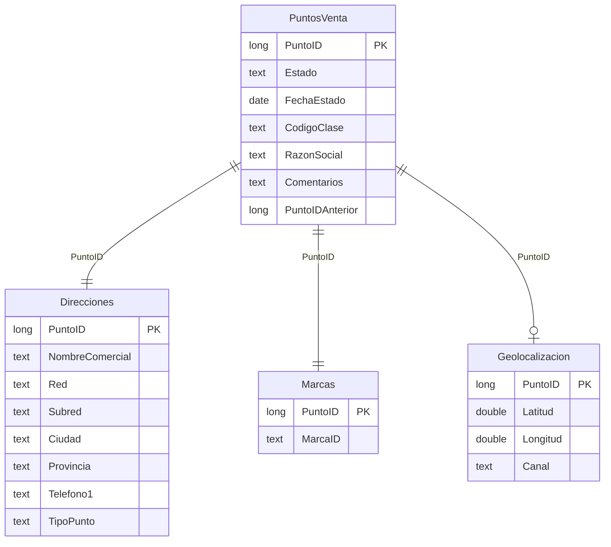

# 🗄️ Reportes con SQL en Microsoft Access

Consultas SQL como las que escribo y ejecuto en **Microsoft Access** para los reportes de mi equipo. Unen varias tablas, filtran, resumen y detectan **problemas de calidad de datos** antes de que lleguen al reporte.

> *SQL portfolio (Microsoft Access dialect): multi-table joins, make-table queries, parameter queries, crosstabs and data-quality checks on a fictional point-of-sale database.*

⚠️ **Datos 100 % ficticios.** Las tablas, los campos y los registros son inventados para este portafolio. Siguen la misma lógica que uso en el trabajo, pero no contienen ningún dato ni nombre interno de la empresa.

---

## La base de datos de ejemplo

Una red de **400 puntos de venta** en Costa Rica, repartida en 4 tablas que se relacionan por `PuntoID`:



A propósito, los datos traen dos problemas reales: **29 puntos sin coordenadas** y **teléfonos repetidos** entre puntos distintos. Dos de las consultas sirven para encontrarlos.

---

## Las consultas

| # | Consulta | Qué responde | Técnicas |
|---|---|---|---|
| 01 | [Ficha de puntos por red](consultas/01_ficha_puntos_por_red.sql) | La ficha completa de cada punto de una red, guardada como tabla para reportes | `SELECT … INTO`, 3 `INNER JOIN` anidados, parámetro |
| 02 | [Conteo por estado](consultas/02_conteo_por_estado.sql) | ¿Cuántos puntos hay activos, cerrados, suspendidos…? | `GROUP BY`, `Count`, `DCount`, `Format` |
| 03 | [Puntos sin geolocalización](consultas/03_puntos_sin_geolocalizacion.sql) | ¿Qué puntos no tienen coordenadas? | `LEFT JOIN` + `Is Null` |
| 04 | [Cambios de estado por mes](consultas/04_cambios_de_estado_por_mes.sql) | ¿Cuántos puntos cambiaron a cada estado, mes a mes? | Referencias cruzadas `TRANSFORM … PIVOT`, parámetros de fecha |
| 05 | [Resumen por red y provincia](consultas/05_resumen_por_red_y_provincia.sql) | Total, activos, cerrados y % de activos por zona | `IIf` dentro de `Sum` (conteo condicional) |
| 06 | [Teléfonos duplicados](consultas/06_telefonos_duplicados.sql) | ¿Qué puntos comparten el mismo teléfono? | Subconsulta con `IN`, `HAVING Count(*) > 1` |

---

## Explicación paso a paso de la consulta principal (01)

Esta es la consulta que más uso: arma en una sola tabla **toda la información de los puntos de una red** para luego usarla en reportes de Excel o Power BI.

```sql
PARAMETERS [Red a consultar] Text ( 255 );          -- 1
SELECT
    pv.PuntoID AS [ID Punto],                        -- 2
    m.MarcaID  AS [ID Marca],
    pv.Estado,
    d.NombreComercial AS [Nombre Comercial],
    ...
INTO [Tbl_Ficha de Puntos]                           -- 3
FROM ((Direcciones AS d
    INNER JOIN PuntosVenta AS pv ON d.PuntoID = pv.PuntoID)    -- 4
    INNER JOIN Marcas AS m ON pv.PuntoID = m.PuntoID)
    INNER JOIN Geolocalizacion AS g ON m.PuntoID = g.PuntoID
WHERE d.Red = [Red a consultar];                     -- 5
```

1. **Parámetro:** al ejecutarla, Access pregunta qué red se quiere consultar. Así sirve la misma consulta para cualquier red, sin editar el SQL.
2. **Alias de columnas (`AS [...]`):** los campos se renombran con nombres claros para quien lee el reporte.
3. **`INTO`:** en lugar de solo mostrar el resultado, lo **guarda como una tabla nueva**. Es la "consulta de creación de tabla" de Access.
4. **`INNER JOIN` anidados:** Access exige paréntesis cuando se unen más de dos tablas. Cada `JOIN` agrega la información de otra tabla usando `PuntoID`.
5. **Filtro:** solo se guardan los puntos de la red indicada.

**Ojo con el `INNER JOIN`:** solo deja los puntos que existen en **las cuatro** tablas. Para la red RN01 la consulta devuelve **102** puntos, pero la red tiene **104**: los 2 que faltan no tienen coordenadas. Por eso existe la consulta **03**, que los encuentra con `LEFT JOIN`.

---

## Resultados de ejemplo

**02 · Conteo por estado**

| Estado | Cantidad | Porcentaje |
|---|---:|---:|
| ACTIVO | 266 | 66.5% |
| CERRADO | 58 | 14.5% |
| SUSPENDIDO | 52 | 13.0% |
| PENDIENTE | 24 | 6.0% |

**04 · Cambios de estado por mes** (del 01/01/2026 al 30/06/2026)

| Mes | ACTIVO | PENDIENTE | SUSPENDIDO | CERRADO |
|---|---:|---:|---:|---:|
| 2026-01 | 8 | | | 1 |
| 2026-02 | 4 | | 2 | 1 |
| 2026-03 | 5 | | 2 | 2 |
| 2026-04 | 10 | | 1 | |
| 2026-05 | 6 | 1 | | 1 |
| 2026-06 | 8 | 1 | | 1 |

**05 · Resumen por red y provincia** (primeras filas)

| Red | Provincia | Total | Activos | Cerrados | % Activos |
|---|---|---:|---:|---:|---:|
| RN01 | ALAJUELA | 20 | 12 | 2 | 60% |
| RN01 | GUANACASTE | 18 | 14 | 0 | 78% |
| RN01 | HEREDIA | 15 | 8 | 4 | 53% |
| RN01 | SAN JOSE | 14 | 10 | 0 | 71% |

**06 · Teléfonos duplicados:** 45 puntos comparten su teléfono con al menos otro punto. Hay que revisarlos antes de usarlos para contactar clientes.

---

## Buenas prácticas que aplico

- **Parámetros en vez de valores fijos:** la misma consulta sirve para cualquier red o rango de fechas.
- **Alias claros** en tablas (`pv`, `d`, `m`, `g`) y columnas, para que el SQL y el reporte se entiendan.
- **Toda columna con nombre:** ninguna sale con el código técnico del campo.
- **Revisar la calidad de los datos** (faltantes y duplicados) antes de entregar un reporte.
- **Saber qué deja fuera cada `JOIN`**, para que no desaparezcan registros sin que nadie lo note.

---

## Cómo probarlo

Ver la [guía de uso](docs/GUIA_DE_USO.md). En resumen: crea una base de Access en blanco, importa el módulo [`vba/CrearBase.bas`](vba/CrearBase.bas) y ejecútalo. Crea las tablas, carga los datos y deja las 6 consultas listas.

## Estructura

```
datos/        4 archivos CSV ficticios + generar_datos.py (script que los crea)
consultas/    6 consultas en SQL de Access, comentadas
vba/          CrearBase.bas: arma la base completa dentro de Access
docs/         Guía de uso
```

---

**Autor:** Elius Mendez · [LinkedIn](https://www.linkedin.com/in/elius-mendez-ramirez-09189a140/) · Licencia [MIT](LICENSE)
